# Argus

**Argus watches your business metrics, investigates what broke on its own, and shows you the cause, the cost and the SQL behind the numbers.**

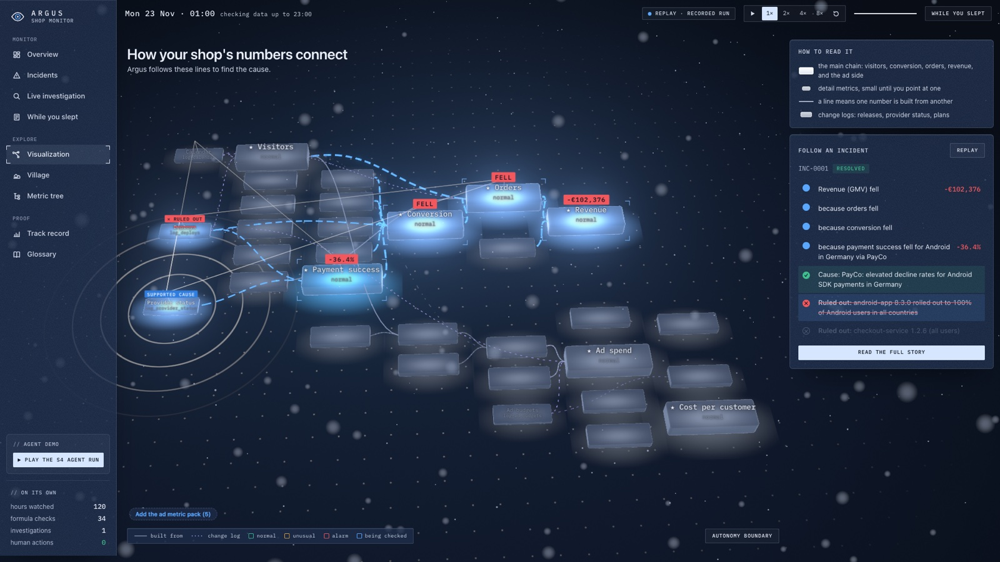

Built for Almedia’s **Eye of the System: Fully Agentic Monitoring** track at HackLab Berlin. Argus runs against MockMart, a simulated shop and ads business with realistic delivery delays, deployment logs and faults.

## Why Argus beats a threshold alert

In the recorded payment incident, success fell **2.40% across the shop** and **36.4% for PayCo on Android in Germany**. An Android release landed at the same time, but Android users outside that segment stayed healthy. Argus ruled the release out, filed one incident and estimated **EUR 21,742 in lost GMV for the first hour**. [Incident and receipt IDs](fixtures/report.md) · [SQL and result hashes](fixtures/receipts.json)

We compared three approaches on the same **18 simulated worlds**, with three seeds each for a quiet control and five scenarios: a provider failure, a planned budget increase, a late data feed, an ad-pacing regression and a market-wide drop followed by a checkout fault. The benchmark commits to the hidden truth before running any agent and checks it after revealing it.

| Approach | Worlds passed | False alarms |
| --- | ---: | ---: |
| **Argus Stage 2 (deterministic)** | **18 / 18** | **0** |
| Stage 1 fixed investigation checklist | 9 / 18 | 6 |
| Threshold alerts on aggregate metrics | 3 / 18 | 21 |

A pass means the runner met the scenario’s grading criteria. A false alarm is a page that touches no fault. These results cover the simulator, and the comparison runs with the language model off. [Scorecard](web/src/views/fixtures/scorecard.sample.json) · [Grading rules](src/bench/grade.py) · [Baselines](src/bench/baselines.py)

Reproduce the comparison with `uv run argus-bench run --agents argus,argus-stage1,threshold --out runs/bench`. The `make bench` target runs the default comparison and checks the [release gate](scripts/agent_eval/bench_gate.py).

The optional model chooses additional checks. The two checked-in live captures logged **$0.0392 for payments (S1)** and **$0.0459 for ad pacing (S4)** in investigation costs, with four model calls apiece. Offline playback makes no provider calls. [S1 cost record](fixtures/agent/v1/s1/activity.jsonl#L16) · [S4 cost record](fixtures/agent/v1/s4/activity.jsonl#L15) · [Cost and replay contract](docs/ext/agent.md#modes)

## Demo

| Watch | Availability |
| --- | --- |
| Live Mission Control | **TODO** · link after deployment is verified |
| Pitch video | **TODO** · final video link |
| Product showcase | **TODO** · final video link |
| Demo recording | **TODO** · final video link |

<!-- TODO(live): insert https://argus.caniberk.dev after deployment verification. -->
<!-- TODO(videos): replace the three placeholders with the final unlisted YouTube or Drive URLs. -->

### Quickstart

In a clone of this repository, run the commands below with [uv](https://docs.astral.sh/uv/), `make` and [Node.js](https://nodejs.org/) 22.12 or newer.

```bash
make web
make api
```

Open [Mission Control](http://127.0.0.1:8000/). The recorded S1 world starts on its own. Use `?fx=night` for the dark theme in the opening screenshot. Select **Play the S4 agent run** in the sidebar to replay the ad-pacing investigation and try the approval flow. This path needs no API key. [Demo controls](docs/ext/demo.md)

For a fresh simulation with live SQL re-runs, use `make demo` in place of `make api`. To run and grade the PayCo investigation in the terminal, use `make s1`.

## Desktop app

Argus Desktop opens Mission Control with the bundled local API and the sealed MockMart replay. Open **Settings** from the app menu to save your own Anthropic API key and run the live agent over the simulated shop.

On macOS, drag `Argus.app` from the unsigned DMG to Applications. For a trusted build, use **right-click Open**, **System Settings → Privacy & Security → Open Anyway**, or `xattr -cr /Applications/Argus.app` if macOS blocks the launch. On Windows, download **Argus-Windows-x64** from a successful Desktop workflow run, extract the ZIP and run the included installer. [Build and installation instructions](desktop/README.md)

## How the app works

### 1. Start with Overview

See shop health, open incidents, estimated impact and decisions waiting for an operator. Open **Track record** for the sealed benchmark or **Incidents** to see both filed incidents and held-back alerts.

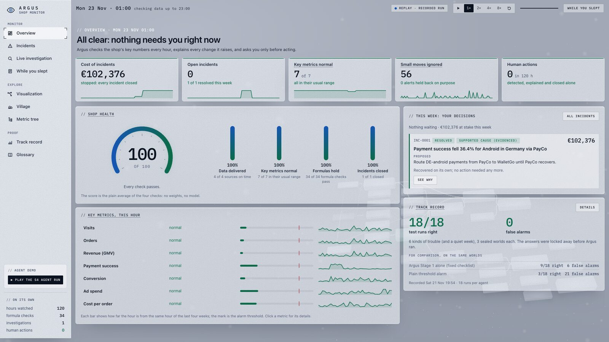

### 2. Open an incident

In S1, open the PayCo incident to see the affected countries, platforms and providers, the cost, and which suspects the evidence ruled out. Select a receipt chip to inspect the SQL, the pinned `as_of` time and the result hash. **Re-run SQL** is available against a live world. A recording carries its captured evidence. [Recorded S1 report](fixtures/report.md) · [Receipts](fixtures/receipts.json)

| Incident | SQL receipt |
| --- | --- |
| 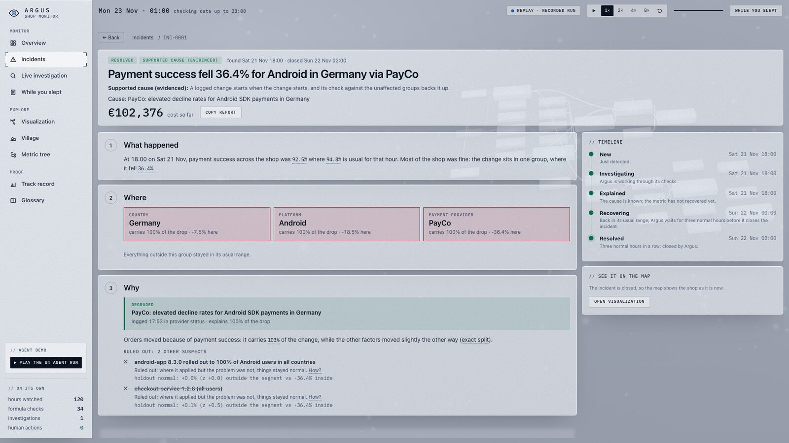 | 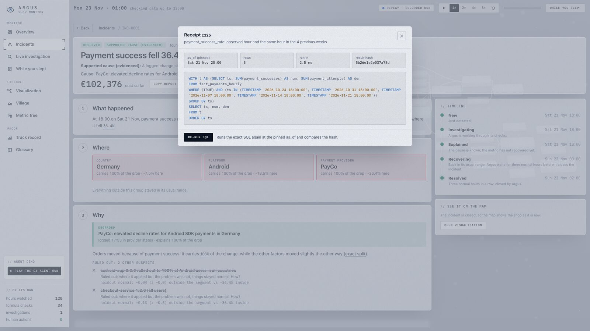 |

### 3. Follow Live investigation

Open **Live investigation** to watch Argus check data completeness, follow the metric graph, narrow the affected segment and test suspects against unaffected groups. **Agent activity** adds the check the model chose, its prediction, what the host found and what the call cost.

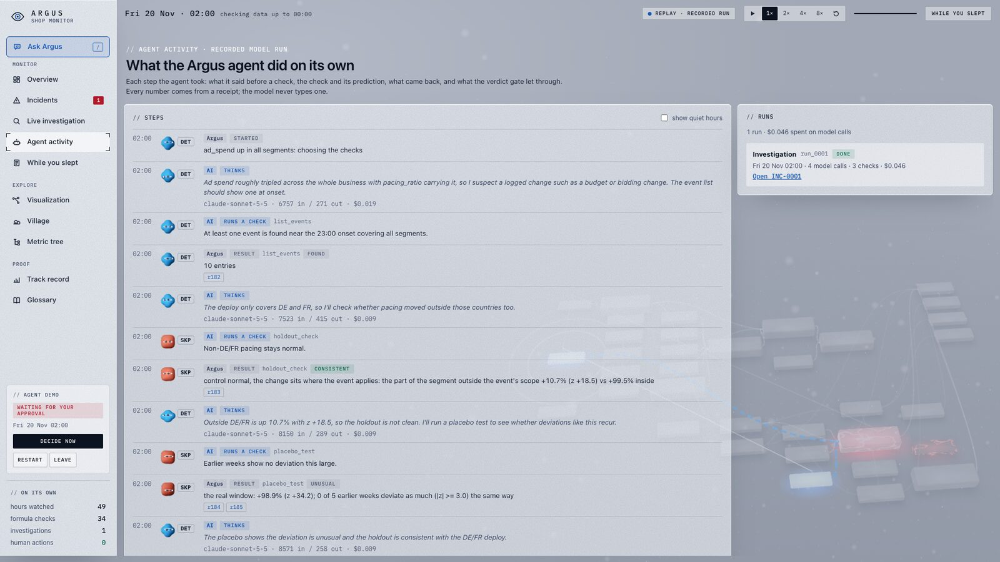

<details>
<summary>Watch a short investigation replay</summary>

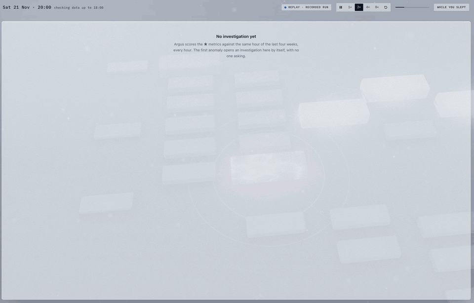

</details>

### 4. Approve a proposed action

Play the **S4 agent run** and open the proposal for the affected German and French budget lines. Review the proposed rollback and its evidence, then approve it to continue the replay. In live simulation, Argus waits for the operator before applying the playbook.

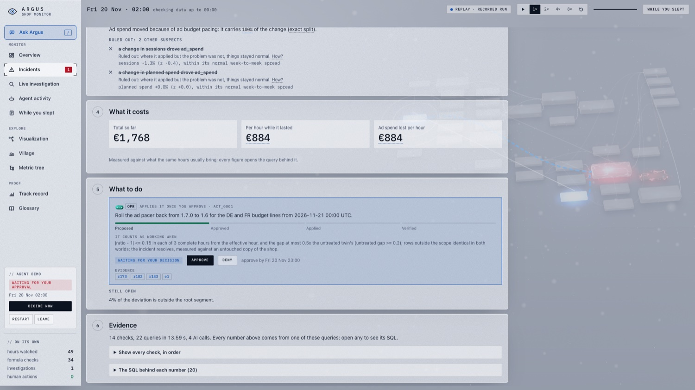

### 5. Verify the outcome

In the approved S4 recording, the pacing ratio returns to **1.01** in the treated shop while its untreated twin stays at **4.05**. Open the outcome to see the receipts for both measurements. [Recorded outcome](fixtures/agent/v1/s4/approve/actions.json) · [SQL receipts e4 and e5](fixtures/agent/v1/s4/approve/receipts.json)

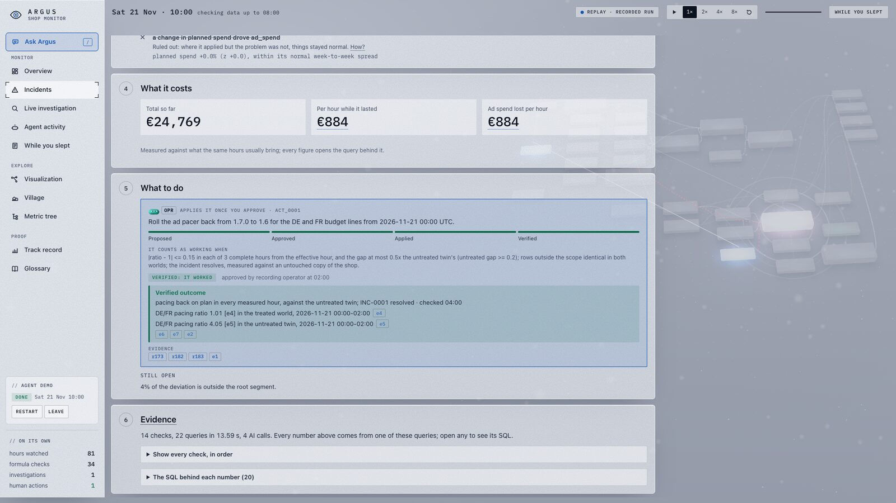

### 6. Ask Argus

Open **Ask Argus** and enter the S4 recording’s question, **Could higher traffic explain the spend?** The read-only answer links to the evidence the investigation used. [Recorded answer](fixtures/agent/v1/s4/ask.jsonl)

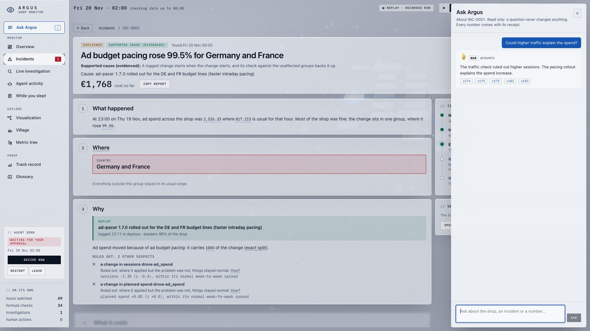

### 7. Explore the Village and Settings

Open **Village** to follow the case as it passes between the watcher, detective, skeptic, narrator, market analyst, operator and cartographer. The **Settings** integration preview shows the operating policy and detector thresholds, with planned changes alongside them in Calendar.

| Village | Settings preview |
| --- | --- |
| 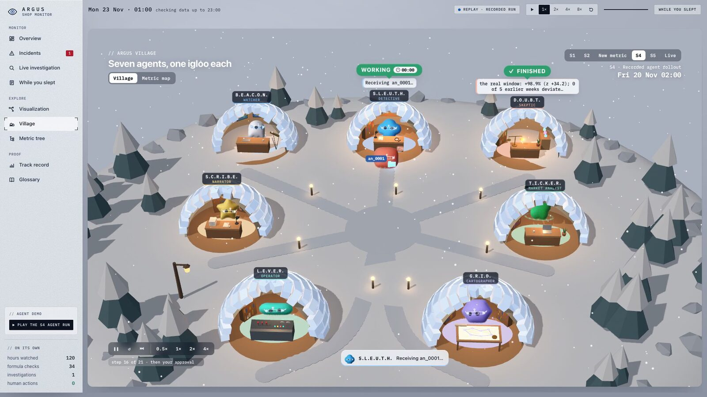 | 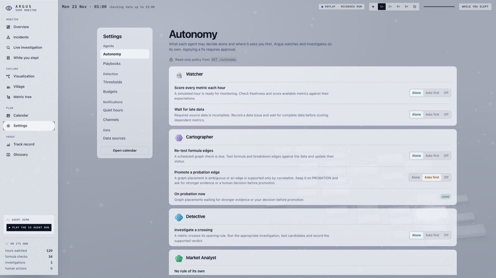 |

### Extend the graph

In **Visualization** or **Metric tree**, select **Add the ad metric pack**. Argus places cost per impression as `CTR × CPC` and attaches the definition check and edge tests. The same flow handles ambiguous and rejected definitions with a certificate explaining the result. [Placement guide](docs/ext/graph-extension.md) · [Recorded placement and SQL receipts](fixtures/graph_extension/placements.json)

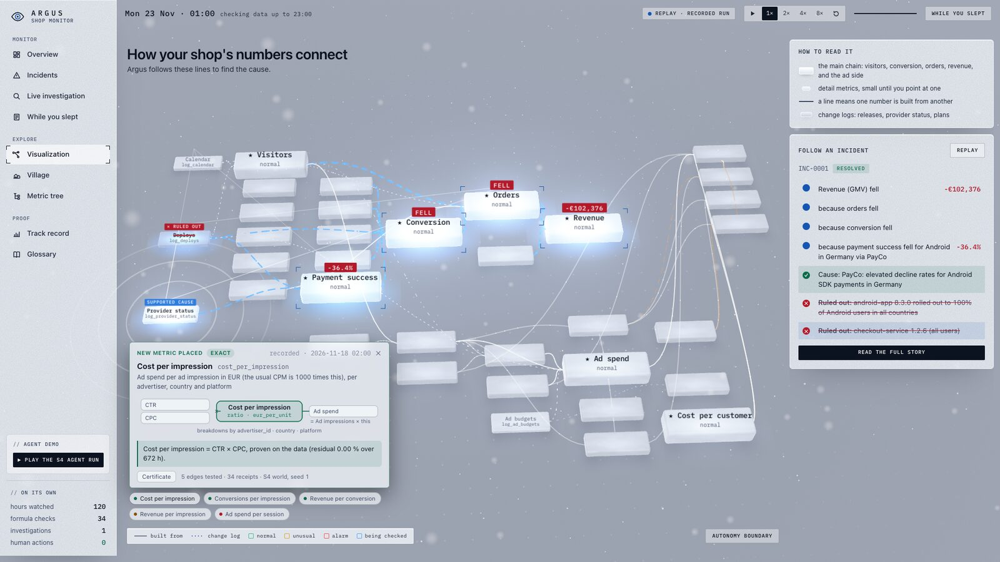

## How Argus meets the Almedia brief

| Criterion | What you can verify |
| --- | --- |
| **Metric graph (40%)** | The seed graph has **27 metrics and 44 typed edges** across the shop funnel and ads business. Argus re-tests formula and breakdown edges on the data each simulated day. Submit a YAML definition with `name`, `description` and `sql` to `POST /graph/metrics` to see automatic placement or a certificate explaining why it could not be placed. [Seed graph](graph/seed_graph.yml) · [Edge tests](src/argus/graph/edge_tests.py) · [Graph extension](docs/ext/graph-extension.md) |
| **Autonomous monitoring and investigation (40%)** | Each simulated hour, Argus checks data delivery, scores key metrics, investigates an uncovered anomaly, and follows the root segment through recovery. The planned S2 spend increase stays in **Didn't wake you** with its evidence. [Runtime](src/argus/runtime/) · [Logged S2 outcome](fixtures/s2/notes.json) · [Decision rules](#how-argus-decides) |
| **Demo (20%)** | Replay the investigation and approval, inspect receipts, or run `uv run argus-bench blind` to grade a case whose truth was sealed before the run. [Demo playback](docs/ext/demo.md) · [Blind challenge](src/bench/blind.py) |

[Track rubric](docs/plan/c8-team-plan-v2.md)

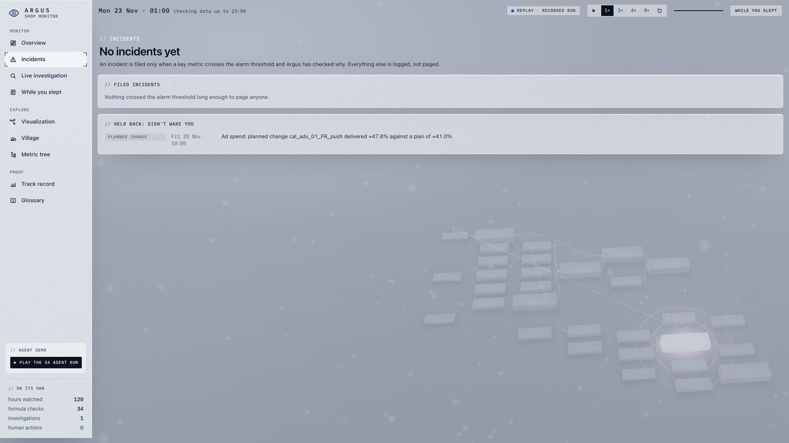

## Architecture

```text
MockMart warehouse
        |
        v
Freshness -> Detect -> Investigate -> Verdict -> Incident or note
                         ^   |                           |
          Metric graph --+   +-> SQL receipts            +-> Sealed bench
        Optional model --+            |                  |        ^
                                      v                  v        |
                                  FastAPI REST + event stream   Hidden truth
                                              |
                                              v
                                       Mission Control
```

MockMart provides business facts, logs and delayed batches in DuckDB. Every investigation query is pinned to the data available at its `as_of` time, and its canonical result hash can be compared on re-run. Only the benchmark reads the separate truth database. [Contracts](docs/contracts.md) · [Semantic layer](src/argus/semantic/)

## How Argus decides

1. **What to watch.** Argus checks freshness before scoring the 7 north-star metrics against their usual hour-of-week behaviour. It opens an anomaly at `|z| > 5`, or `|z| > 3.5 in 2 of the last 3 hours` in the same direction. A planned change adds a check on its segment for 24 hours. The optional attention budget of 6 more looks per tick is implemented and tested separately from the runtime.
2. **Which edge to follow.** Formula edges split the change using additive LMDI. Argus follows the factor whose movement exceeds its usual spread (|z| >= 3). Breakdown edges show which dimensions to examine, and evidence edges point to the logs that can explain what changed.
3. **Which group to check.** Argus seeks the smallest set of at most 3 values of one dimension that explains at least 67% of the deviation. It descends when a single group’s share of the deviation exceeds its share of volume by 25 points and `|z| >= 3`. It checks suspects from 3 hours before to 1 hour after the segment’s onset using the unaffected scope or neighbouring groups, then looks for the same deviation in up to 8 earlier weeks as a placebo.
4. **When to stop.** Argus judges at most 12 checks and asks the optional planner for more only while the explained share is below 80%. A supported cause needs an aligned event validated by a holdout or control, a root with `|z| >= 3`, at least 20% explained, and a placebo that does not recur. If evidence falls short, Argus reports a hypothesis or an unexplained verdict and records the unexplained share.

The optional agent writes a prediction and picks a typed check. The engine runs and judges it, verifies the numbers and admits the verdict. Provider failures and exhausted budgets fall back to the deterministic investigation in the same tick. The same engine files and resolves incidents automatically. Applying a playbook requires human approval. [Thresholds and rules](docs/ALGORITHM.md) · [Agent contract](docs/ext/agent.md)

### Agent intelligence and release evals

The model chooses what to check. Argus decides what the evidence supports.

| Technique | What it does | What keeps it honest | Release eval |
| --- | --- | --- | --- |
| Competing hypotheses | Puts rival causes and their cheapest decisive checks on a board | Judged checks determine each card's status | E18 checks 8 positive board reconstructions and 3 negative scenarios |
| Self-written checks | Writes a SELECT for a cut outside the fixed tool menu | A parser limits queries to as-of views. A receipt pins the result. Stage 2 alone can grant a supported cause | E19 requires 28 SQL rejections, 10 accepted cuts and visibility at `as_of`. E20 checks both directions of a PayCo comparison |
| Counter-check | A second model in a fresh context tries to falsify a supported cause | Code judges the receipts and can downgrade the verdict | E21 requires 3 of 3 planted false causes removed and 0 of 6 true causes vetoed. E22 checks verdict safety across 18 cases |
| Case memory | Uses past denials and verified outcomes when considering another proposal | The deterministic proposal policy reads memory as advice. Evidence comes from checks | E23 checks denial and approval precedents. E24 requires identical verdicts, roots and proposals in 3 poisoned-memory trials |
| Cause chain | Links the event, root segment, formula hops and EUR impact | Every link carries a receipt that can be re-run | E25 checks 6 supported cases and 3 negative scenarios |
| Budget | Stops the detective and critic at fixed caps | Stage 2 completes in the same tick | E26 checks caps of 12 detective calls and 3 critic calls, exact recorded cost and zero replay spend |

The host verifies numbers against receipts. The deterministic investigation rules govern supported causes. Operator approval is required, and the playbook derives the action parameters.

The default v1 profile has 17 offline agent evals. The v2 release requires the
intelligence evals and six retained live trials, with three passes each on S1
and S4. Live v2 qualification is pending. Sealed v1 investigation cassettes
replay the provider exchange and activity offline byte for byte.
See the [v2 capture and qualification guide](fixtures/agent/v2/README.md).

## Tech stack

Python and DuckDB power the simulator and investigation engine. sqlglot handles SQL lineage and Pydantic defines the contracts. FastAPI serves REST and server-sent events. Mission Control is TypeScript and React built with Vite, with Three.js and React Flow for graph views. The Anthropic SDK is optional for live model calls.

## Prior work and inspiration

- **Investigation methods.** The metric walk uses additive LMDI. Segment localisation draws on Adtributor, HotSpot and RiskLoc. The mix and rate split follows E. M. Kitagawa (*JASA*, 1955), and robust z-scores use the median absolute deviation described by Iglewicz and Hoaglin (ASQC, 1993). [LMDI guide](https://doi.org/10.1016/j.enpol.2003.10.010) · [Adtributor](https://www.usenix.org/conference/nsdi14/technical-sessions/presentation/bhagwan) · [HotSpot](https://doi.org/10.1109/ACCESS.2018.2804764) · [RiskLoc](https://arxiv.org/abs/2205.10004)
- **Agent design.** ReAct informed the check-and-observe loop, Reflexion informed counter-checking and case memory, and Tree of Thoughts informed the competing-hypotheses design. [ReAct](https://arxiv.org/abs/2210.03629) · [Reflexion](https://arxiv.org/abs/2303.11366) · [Tree of Thoughts](https://arxiv.org/abs/2305.10601)
- **UI credit.** The agent timeline and composer redesign draws on T3 Code, including folded runs, inline approvals, follow-tail scrolling and question history. The React implementation adapts the follow-tail state machine and the rule for the live status line. [T3 Code](https://github.com/pingdotgg/t3code) · [MIT notice](#built-on)

### Evaluated and not used

- Merlion's evaluated release required NumPy below 2 and brought in a forecasting stack.
- PyRCA's evaluated release required scikit-learn below 1.2 and a Java bridge.
- DoWhy resolved to 45 packages in the evaluation. MockMart's untreated twin provides the comparison for action effects.

## Built on

Argus’s core monitoring and investigation algorithms were implemented during the hackathon. Dependencies come from PyPI and npm. Versions below follow the repository’s [Python lockfile](uv.lock) and [web lockfile](web/package-lock.json).

| Library | Locked version | License | Role |
| --- | --- | --- | --- |
| Anthropic SDK | 2.12.0 | Apache-2.0 | Optional live model transport |
| DuckDB | 2.0.1 | MIT | Simulator, as-of queries and receipts |
| sqlglot | 30.33.0 | MIT | SQL parsing, validation and lineage |
| FastAPI / Starlette / Uvicorn | 0.165.0 / 1.10.0 / 0.54.0 | MIT / BSD-3-Clause / BSD-3-Clause | HTTP and streaming |
| Pydantic / PyYAML | 2.14.4 / 6.0.4 | MIT / MIT | Data contracts, metric and playbook definitions |
| NumPy / pandas | 2.5.5 / 3.1.1 | BSD-3-Clause / BSD-3-Clause | Statistics and simulation |
| React / React DOM | 19.3.1 | MIT | Mission Control |
| React Flow / Three.js | 13.0.2 / 0.187.0 | MIT / MIT | Metric graph and 3D scenes |
| Fontsource IBM Plex Mono / Bot Avatars | 5.3.0 / 0.2.2 | OFL-1.1 / MIT | Typography and avatars |
| TypeScript / Vite / Vite React plugin / Vitest | 7.0.2 / 8.3.8 / 6.3.0 / 5.1.1 | Apache-2.0 / MIT / MIT / MIT | Web build and tests |
| pytest / Ruff / mypy / httpx2 | 9.2.0 / 0.17.6 / 2.4.1 / 2.16.2 | MIT / MIT / MIT / BSD-3-Clause | Python tests and checks |
| PyYAML type stubs | 6.0.12.20261113 | Apache-2.0 | Python type checking |
| React / React DOM / Three.js type stubs | 19.3.0 / 19.3.0 / 0.187.0 | MIT | Web type checking |

<details>
<summary>T3 Code license (MIT)</summary>

```text
MIT License

Copyright (c) 2026 T3 Tools Inc.

Permission is hereby granted, free of charge, to any person obtaining a copy
of this software and associated documentation files (the "Software"), to deal
in the Software without restriction, including without limitation the rights
to use, copy, modify, merge, publish, distribute, sublicense, and/or sell
copies of the Software, and to permit persons to whom the Software is
furnished to do so, subject to the following conditions:

The above copyright notice and this permission notice shall be included in all
copies or substantial portions of the Software.

THE SOFTWARE IS PROVIDED "AS IS", WITHOUT WARRANTY OF ANY KIND, EXPRESS OR
IMPLIED, INCLUDING BUT NOT LIMITED TO THE WARRANTIES OF MERCHANTABILITY,
FITNESS FOR A PARTICULAR PURPOSE AND NONINFRINGEMENT. IN NO EVENT SHALL THE
AUTHORS OR COPYRIGHT HOLDERS BE LIABLE FOR ANY CLAIM, DAMAGES OR OTHER
LIABILITY, WHETHER IN AN ACTION OF CONTRACT, TORT OR OTHERWISE, ARISING FROM,
OUT OF OR IN CONNECTION WITH THE SOFTWARE OR THE USE OR OTHER DEALINGS IN THE
SOFTWARE.
```

</details>

## Team

Built at HackLab Berlin by [Batu](https://github.com/BatuCani), [Alan](https://github.com/Lumberj3ck), [Ansor](https://github.com/TheWingTheWong) and [Youssef](https://github.com/youssef-110).

Mission Control’s design stays fixed unless Batu agrees to a change. [Contributing](CONTRIBUTING.md)

## License

[MIT](LICENSE). MockMart’s companies, advertisers and payment providers are fictional.
