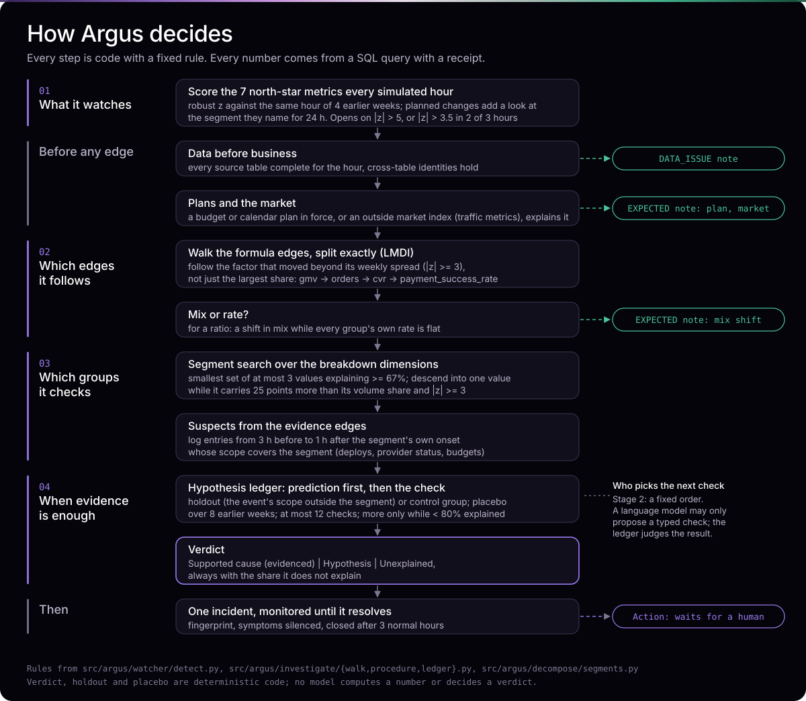

# How Argus decides

One page on the four choices the track brief asks about: what Argus watches, which edges it follows, which groups it checks, and when the evidence is enough.
Every rule below is a constant in the code; the file is named next to it.

## 1. What it watches

- Every simulated hour Argus scores the 7 north-star metrics of the seed graph (sessions, orders, GMV, payment success rate, conversion rate, ad spend, CPA) against the same hour of the 4 earlier weeks, with a robust z-score (`src/argus/watcher/detect.py`).
- An anomaly opens at |z| > 5, or at |z| > 3.5 in 2 of the last 3 hours on the same side; both thresholds were calibrated on 40 quiet worlds (`docs/decisions.md`).
- A metric whose source table is incomplete for the hour is pending, not scored; a lagging table becomes one DATA_ISSUE note.
- A planned change in force (budget change, calendar entry) is a reason to look at exactly the segment it names for 24 hours; a step there opens an anomaly (`src/argus/detect/planned.py`).
- Everything below the north stars is examined only when a north star moves: the investigation walks down the graph.
  That keeps about 7 statistical tests per hour instead of hundreds of slices that would page on noise.
- Not in the running system yet: the attention budget in `src/argus/detect/attention.py` (score = business weight x surprise x data confidence x novelty, 6 extra looks per tick) is built and unit-tested (`tests/detect/test_detect_attention.py`) and runs with `uv run python -m argus.detect --world <world.duckdb>`, but the runtime does not call it, so recorded runs contain no `attention` events.

## 2. Which edges it follows

The seed graph has 27 nodes and 44 typed edges: 7 formula, 27 breakdown, 9 evidence, 1 cause (`graph/seed_graph.yml`).

- **Formula edges** are followed first, hop by hop (`gmv -> orders -> cvr -> payment_success_rate`), with an exact additive LMDI split that has zero residual (`src/argus/investigate/walk.py`).
  Argus follows the largest contribution among the factors that moved beyond their week-to-week spread (|z| >= 3), not just the largest share; when no factor is significant it takes the largest share and the trail says the choice is weak.
  A ratio identity (`ad_spend = planned_spend x pacing_ratio`) is a second exact split.
- **Mix or rate**: for a ratio, a shift in the mix of groups while every group's own rate is flat is EXPECTED (Simpson's paradox), not an incident.
- **Breakdown edges** give the dimensions for the segment search (section 3).
- **Evidence edges** say which logs can move a node (deploys, provider status, budgets, calendar); for a ratio, also the logs of its numerator and denominator.
- **Cause edges** are not followed by the deterministic walk; they stay PROPOSED until tested and are only listed to a planner as the node's neighbourhood.
- Every formula and breakdown edge is re-tested against the data once per simulated day (`src/argus/graph/edge_tests.py`); a failing edge becomes BROKEN, is not used for the split, and a broken identity marks a data problem rather than a business one.

## 3. Which groups it checks

- **Segment search** (`src/argus/decompose/segments.py`): for every value of every dimension, the explanatory power is that value's share of the deviation.
  Argus picks the smallest set of at most 3 values, each carrying at least 10%, that explains at least 67%, preferring the dimension with the fewest values and the most concentrated deviation.
- **Descent**: it goes one level deeper into a single value only while that value carries at least 25 points more of the deviation than of the volume and its own |z| >= 3, so it ends at `DE / android / PayCo` instead of stopping at `DE`.
- **Suspects**: log entries from the evidence edges, from 3 hours before to 1 hour after the root segment's own onset, whose scope covers the segment; entries of one rollout count as one suspect (`src/argus/investigate/procedure.py`).
- **Holdout**: each suspect is tested on its scope outside the segment.
  If that part is normal (|z| < 2 and less than half the inside change), the suspect is ruled out; if it moves the same way (at least half, |z| >= 2), it stays; anything between is inconclusive and keeps it a hypothesis.
  When the scope is exactly the segment, the neighbouring groups the event did not touch serve as the control group instead.
- **Placebo**: the same hours in up to 8 earlier weeks; a deviation like this in 2 or more of them means it may be noise.

## 4. When the evidence is enough

- Every check is a hypothesis in a ledger: the prediction is written first, the typed check runs second, and code reads the outcome third (`src/argus/investigate/ledger.py`).
- One investigation runs at most 12 checks; suspects left over are named as untested in the trail.
- Early stops: incomplete data or a broken identity is a DATA_ISSUE; a plan in force that delivery follows, an outside market index that moves the same way, or a mix shift is EXPECTED; none of them pages anyone.
- Further checks are proposed only while less than 80% of the deviation is explained and checks remain; the trail ends with the reason, for example `stop: explained 100% >= 80%`.
- **Supported cause (evidenced)** (`SUPPORTED_CAUSE`) needs all four: a suspect aligned with the onset that its holdout or control check validates, a root segment with |z| >= 3, at least 20% explained, and a placebo that does not recur.
- **Hypothesis** (`HYPOTHESIS`): the change is localised and significant, but no logged change is validated.
- **Unexplained** (`UNEXPLAINED`): nothing localises and no logged change lines up.
- Every verdict states the share it does not explain; every claim in the findings is labelled evidence or hypothesis (`src/argus/investigate/claims.py`), and every report line with a number cites a receipt (the S1 bench criterion `receipts_reproducible` checks it).

## Where the language model fits

- The deterministic path needs no model: the recorded S1 investigation makes 0 LLM calls (`fixtures/report.md`).
- A model may only propose the next check: the `Planner` interface (`src/argus/investigate/planner.py`) takes typed checks from the C6 tool menu with a prediction and an expected outcome, and drops anything else.
  The investigator runs each check itself and the ledger judges it, so a model can never produce a number or a verdict.
- Prose that contains numbers must pass the number check: every number comes from a receipted query of the run (`src/argus/narrator/report.py`).
- Without a planner, the remainder is reported as unexplained with its share.

## Human approval

- Every suggested action carries `needs_approval = true` (`src/argus/contracts/findings.py`); Argus files, merges and closes incidents on its own but does not act on the business.
- `GET /autonomy` serves the boundary: what Argus decides alone and what it asks first (`src/argus/narrator/autonomy.py`).

The same four answers as one slide for the pitch film: [docs/pitch/algorithm-slide.png](pitch/algorithm-slide.png).
